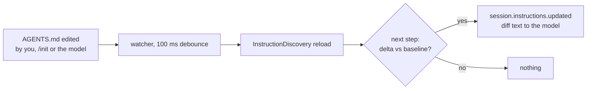

# Memory

|                     |                                            |
| ------------------- | ------------------------------------------ |
| **opencode commit** | `80fb31ebb7e8dfa5c26fc51ca81da8e06b618a52` |
| **Researched**      | 2026-10-19                                 |
| **Sources**         | source · docs · GitHub issues and PRs      |

## Summary

opencode has **no memory feature**: no memory tool, no auto-memory, no
"remember this" command, no `#` quick-add, no memory directory, no flag.
What persists knowledge across sessions is the instruction files: the
global `~/.config/opencode/AGENTS.md` and every `AGENTS.md` from the working
directory up. `/init` writes the project one; otherwise only the model's
own edits (nudged by a few model prompts) or yours change them. The one
idea worth keeping: the files are **watched**, and a change mid-session
reaches the model as a diff message, so a file the agent edits is read
back without a restart. Memory proper is left to plugins and MCP servers;
every request for it on GitHub was closed or still sits open.

## User-facing behaviour

- **No memory command or tool.** The built-in commands are `init`,
  `review` and MCP prompts ([`command.ts:29-54`](https://github.com/anomalyco/opencode/blob/80fb31ebb7e8dfa5c26fc51ca81da8e06b618a52/packages/core/src/plugin/command.ts#L29-L54)); the tools are
  edit, file-diff, glob, grep, mcp-resource, opencode, patch, question,
  read, shell, skill, subagent, webfetch, websearch, write
  (`packages/core/src/tool/plugin/`). [source]
- **`/init`** — "guided AGENTS.md setup": a prompt that has the model read
  the repo and create or improve `AGENTS.md` in the project root. [source] [docs]
- **Global `~/.config/opencode/AGENTS.md`** applies to every session; the
  docs recommend it for "personal rules" ([`rules.mdx:71-75`](https://github.com/anomalyco/opencode/blob/80fb31ebb7e8dfa5c26fc51ca81da8e06b618a52/packages/web/src/content/docs/rules.mdx#L71-L75)). [docs] [source]
- **Project `AGENTS.md`** from the working directory up to the home
  directory (or project root), and nested ones attached when `read` touches
  their folder. [source]
- **Editing an `AGENTS.md` mid-session** is picked up on the next step,
  shown to the model as "The instructions from … changed. Here's the diff".
  [source]
- **Docs drift.** The docs still promise a `CLAUDE.md` fallback,
  `~/.claude/CLAUDE.md`, `OPENCODE_DISABLE_CLAUDE_CODE*` and an
  `instructions` list of paths, globs and URLs ([`rules.mdx:77-131`](https://github.com/anomalyco/opencode/blob/80fb31ebb7e8dfa5c26fc51ca81da8e06b618a52/packages/web/src/content/docs/rules.mdx#L77-L131)). At
  the pin none of that is in the source: it was v1 behaviour, deleted with
  `packages/opencode` in `44b6938` (see How it works, step 6). [docs] [source]
- **Ecosystem**: the docs list one memory plugin,
  [opencode-supermemory](https://github.com/supermemoryai/opencode-supermemory)
  ("Persistent memory across sessions using Supermemory",
  [`ecosystem.mdx:42`](https://github.com/anomalyco/opencode/blob/80fb31ebb7e8dfa5c26fc51ca81da8e06b618a52/packages/web/src/content/docs/ecosystem.mdx#L42)). [docs]

### Evidence of absence

Grepped `refs/opencode/packages` (excluding `node_modules` and the
models.dev snapshot) for `memory`/`memories`, `remember`, `recall`, `memo`,
`knowledge`, `learn`/`learnings`, `AGENTS.md`, `CLAUDE.md`,
`DISABLE_CLAUDE_CODE`, `experimental`, and a `#` prompt prefix in the TUI:

| Hit                                         | What it is                                                       |
| ------------------------------------------- | ---------------------------------------------------------------- |
| `core/src/environment/memory.ts`            | an in-memory filesystem driver for tests                         |
| `plugin/src/tui/context.ts:47` `memory()`   | ephemeral TUI plugin state, gone when the TUI exits              |
| `model-request.ts:46`                       | "Do not make claims about its contents from memory" (image note) |
| `system-prompt/meta.txt:25`                 | "Remember active user corrections … across turns" (one session)  |
| `tool/plugin/websearch.ts:20`               | "beyond knowledge cutoff"                                        |
| `tui/src/prompt/mention.ts:112`             | a memo cache                                                     |
| `schema/src/config/experimental.ts`         | only `portable_shell_scanner`, `subagent_depth`, `policies`      |
| `#` in `packages/tui/src`                   | hex colours and comment lines in attachments; no quick-add       |
| `CLAUDE.md`, `DISABLE_CLAUDE_CODE` in `.ts` | none                                                             |

Nothing in `packages/core`, `packages/plugin`, `packages/schema`,
`packages/tui` or `packages/cli` stores facts for the model across sessions.

### On GitHub [issue]

| #                                                                                                                        | What                                                              | State                                                          |
| ------------------------------------------------------------------------------------------------------------------------ | ----------------------------------------------------------------- | -------------------------------------------------------------- |
| [#20322](https://github.com/anomalyco/opencode/issues/20322)                                                             | Native auto-memory for cross-session learning (SQLite, extracted) | closed not planned (stale bot, Oct 2026)                       |
| [#21660](https://github.com/anomalyco/opencode/issues/21660)                                                             | Claude Code's auto memory and auto dream                          | closed not planned (stale)                                     |
| [#30124](https://github.com/anomalyco/opencode/issues/30124)                                                             | onSessionStart hooks for auto memory recall                       | closed                                                         |
| [#41998](https://github.com/anomalyco/opencode/issues/41998), [#42425](https://github.com/anomalyco/opencode/pull/42425) | `agent_memory` table and memory-tools plugin                      | closed (template bot)                                          |
| [#48497](https://github.com/anomalyco/opencode/issues/48497)                                                             | `/teach`, `/recall`, `/learn`, `/memory` long-term memory         | open, no maintainer reply                                      |
| [#48498](https://github.com/anomalyco/opencode/pull/48498)                                                               | its PR: SQLite memory in core                                     | closed: "upgraded to V2 … no longer taking PRs for V1" (thdxr) |
| [#43068](https://github.com/anomalyco/opencode/issues/43068)                                                             | per-folder notebook memory (`notes_get`/`notes_commit`)           | open                                                           |
| [#52934](https://github.com/anomalyco/opencode/issues/52934)                                                             | external memory as a first-class extension category               | closed (template bot)                                          |
| #49559, #50060, #52142, #53222, #56024                                                                                   | requests to list memory plugins/MCP servers on the ecosystem page | open                                                           |

No maintainer has said memory is planned; the only maintainer word is the
V1→V2 bulk close. The pattern is the community shipping memory as plugins
(supermemory, honcho, mempalace, opencode-claude-memory) and MCP servers.

## Where it lives

```
packages/
├── core/src/
│   ├── config/plugin/instruction.ts   # global + walked-up AGENTS.md, watched
│   ├── instruction-discovery.ts       # the instruction source: render, diff on change
│   ├── session/
│   │   ├── instruction-state.ts       # per-session baseline; emits session.instructions.updated
│   │   ├── instructions.ts            # nested AGENTS.md as a synthetic message, deduped
│   │   ├── runner/llm.ts              # prepareContext: instructions before each step
│   │   └── compaction.ts              # summary leaves AGENTS.md out
│   ├── tool/plugin/read.ts            # read walks up for nested AGENTS.md
│   └── plugin/
│       ├── command.ts                 # /init and /review
│       ├── command/initialize.txt     # the /init prompt
│       └── host.ts                    # plugin storage (KV, namespaced per plugin)
├── plugin/src/effect/
│   ├── session.ts                     # hooks a memory plugin would use
│   └── storage.ts                     # get/set/remove/scan
└── schema/src/config.ts               # `instructions` key: declared, never read
```

## How it works

1. **Candidates** — the instruction plugin watches the global
   `<config>/AGENTS.md` and `AGENTS.md` in every directory from the working
   directory to the home directory (when under it) or the project root
   ([`instruction.ts:36-55`](https://github.com/anomalyco/opencode/blob/80fb31ebb7e8dfa5c26fc51ca81da8e06b618a52/packages/core/src/config/plugin/instruction.ts#L36-L55)). Only `AGENTS.md`: no `CLAUDE.md`
   fallback. `discovery.global` / `discovery.project` turn either scope off.
2. **Load** — global first, then the walk nearest-to-farthest
   ([`instruction.ts:63-79`](https://github.com/anomalyco/opencode/blob/80fb31ebb7e8dfa5c26fc51ca81da8e06b618a52/packages/core/src/config/plugin/instruction.ts#L63-L79)); an unreadable file marks the whole source
   `unavailable` rather than dropping it silently.
3. **Watch** — file events go through a sliding PubSub, are debounced
   100 ms, then re-read and `discovery.reload()`
   ([`instruction.ts:110-117`](https://github.com/anomalyco/opencode/blob/80fb31ebb7e8dfa5c26fc51ca81da8e06b618a52/packages/core/src/config/plugin/instruction.ts#L110-L117)).
4. **Render** — first time, `Instructions from: <path>\n<content>` per file
   ([`instruction-discovery.ts:123-125`](https://github.com/anomalyco/opencode/blob/80fb31ebb7e8dfa5c26fc51ca81da8e06b618a52/packages/core/src/instruction-discovery.ts#L123-L125)); after a change, per file
   "no longer apply", "New instructions apply from", or a unified diff,
   whichever of diff and full text is shorter
   ([`instruction-discovery.ts:127-149`](https://github.com/anomalyco/opencode/blob/80fb31ebb7e8dfa5c26fc51ca81da8e06b618a52/packages/core/src/instruction-discovery.ts#L127-L149)).
5. **Per step** — before every step the runner compares the current
   instructions with the session's stored baseline
   ([`llm.ts:198-203`](https://github.com/anomalyco/opencode/blob/80fb31ebb7e8dfa5c26fc51ca81da8e06b618a52/packages/core/src/session/runner/llm.ts#L198-L203)); a delta is committed as a durable
   `session.instructions.updated` event with the rendered text frozen into
   it ([`instruction-state.ts:38-61`](https://github.com/anomalyco/opencode/blob/80fb31ebb7e8dfa5c26fc51ca81da8e06b618a52/packages/core/src/session/instruction-state.ts#L38-L61), [`session-event.ts:261`](https://github.com/anomalyco/opencode/blob/80fb31ebb7e8dfa5c26fc51ca81da8e06b618a52/packages/schema/src/session-event.ts#L261)). So an
   `AGENTS.md` the model just edited is seen by the model as a diff on its
   next step, without rebuilding the system prompt (cache kept).
6. **Gone from v1** — v1's `instruction.ts` also read `CLAUDE.md`,
   `~/.claude/CLAUDE.md` and deprecated `CONTEXT.md`
   ([v1 `instruction.ts:60-68`](https://github.com/anomalyco/opencode/blob/fc7e4cf93e660ad5ddabb0c48ecc99e934ebfe95/packages/opencode/src/session/instruction.ts#L60-L68)), and loaded `config.instructions` paths
   and URLs ([v1 `:135-160`](https://github.com/anomalyco/opencode/blob/fc7e4cf93e660ad5ddabb0c48ecc99e934ebfe95/packages/opencode/src/session/instruction.ts#L135-L160)). At the pin, `instructions` is still in
   the config schema ([`config.ts:90-92`](https://github.com/anomalyco/opencode/blob/80fb31ebb7e8dfa5c26fc51ca81da8e06b618a52/packages/schema/src/config.ts#L90-L92)) and normalized
   ([`normalize.ts:226-227`](https://github.com/anomalyco/opencode/blob/80fb31ebb7e8dfa5c26fc51ca81da8e06b618a52/packages/core/src/config/normalize.ts#L226-L227)) but nothing reads it; the `.claude`
   compatibility roots feed skills only ([`compatibility.ts:39-40`](https://github.com/anomalyco/opencode/blob/80fb31ebb7e8dfa5c26fc51ca81da8e06b618a52/packages/core/src/config/plugin/compatibility.ts#L39-L40)).
7. **Nested files** — after a read, `read` walks up from the file (or the
   listed directory) to the working directory, exclusive, for `AGENTS.md`
   ([`read.ts:82-100`](https://github.com/anomalyco/opencode/blob/80fb31ebb7e8dfa5c26fc51ca81da8e06b618a52/packages/core/src/tool/plugin/read.ts#L82-L100)); `SessionInstructions.load` injects new ones as a
   synthetic message whose metadata is the dedup ledger, so a file whose
   message fell out by compaction or revert is injected again
   ([`instructions.ts:35-93`](https://github.com/anomalyco/opencode/blob/80fb31ebb7e8dfa5c26fc51ca81da8e06b618a52/packages/core/src/session/instructions.ts#L35-L93)).
8. **Who writes the files** — only `/init`
   ([`command.ts:29-41`](https://github.com/anomalyco/opencode/blob/80fb31ebb7e8dfa5c26fc51ca81da8e06b618a52/packages/core/src/plugin/command.ts#L29-L41)), whose prompt aims at "a compact
   instruction file that helps future OpenCode sessions avoid mistakes" and
   improves an existing one in place
   ([`initialize.txt:3`](https://github.com/anomalyco/opencode/blob/80fb31ebb7e8dfa5c26fc51ca81da8e06b618a52/packages/core/src/plugin/command/initialize.txt#L3), [`:65`](https://github.com/anomalyco/opencode/blob/80fb31ebb7e8dfa5c26fc51ca81da8e06b618a52/packages/core/src/plugin/command/initialize.txt#L65)). Beyond it, two model
   prompts ask the model to write back: trinity suggests writing a lint
   command the user supplied to `AGENTS.md`
   ([`trinity.txt:77`](https://github.com/anomalyco/opencode/blob/80fb31ebb7e8dfa5c26fc51ca81da8e06b618a52/packages/core/src/plugin/system-prompt/trinity.txt#L77)), kimi must update `AGENTS.md` when it changes
   what they describe ([`kimi.txt:83`](https://github.com/anomalyco/opencode/blob/80fb31ebb7e8dfa5c26fc51ca81da8e06b618a52/packages/core/src/plugin/system-prompt/kimi.txt#L83)). The edit goes through the normal
   write/edit tools.
9. **Compaction** leaves instruction files out of the summary, since "the
   next agent receives current versions of all of these separately"
   ([`compaction.ts:147`](https://github.com/anomalyco/opencode/blob/80fb31ebb7e8dfa5c26fc51ca81da8e06b618a52/packages/core/src/session/compaction.ts#L147)).



## Key data types / interfaces

The hooks and storage a memory plugin builds on
([`session.ts:25-35`](https://github.com/anomalyco/opencode/blob/80fb31ebb7e8dfa5c26fc51ca81da8e06b618a52/packages/plugin/src/effect/session.ts#L25-L35), [`:138-141`](https://github.com/anomalyco/opencode/blob/80fb31ebb7e8dfa5c26fc51ca81da8e06b618a52/packages/plugin/src/effect/session.ts#L138-L141), [`storage.ts:4-9`](https://github.com/anomalyco/opencode/blob/80fb31ebb7e8dfa5c26fc51ca81da8e06b618a52/packages/plugin/src/effect/storage.ts#L4-L9)):

```ts
export interface SessionRequest {
  readonly sessionID: Session.ID
  readonly model: Model.Ref
  system: Array<SystemPart>      // a plugin can add recalled memory here
  messages: Array<Message>
  options: SessionRequestOptions
}
export interface SessionHooks {
  readonly prompt: SessionPrompt        // see / rewrite each prompt
  readonly context: SessionContext      // system, messages, tools per request
  readonly compaction: SessionCompaction // capture what a summary drops
  ...
}
export interface StorageDomain {        // KV namespaced per plugin id (host.ts:609)
  readonly get / set / remove / scan
}
```

Plus `ctx.tool` to register a `remember`-style tool. Nothing in core uses
these for memory.

## Design decisions & trade-offs

- **Observed:** memory is files in the repo or config dir, not a store —
  versioned with git, readable, editable by any tool, shared with the team
  for the project file.
- **Observed:** instruction changes are deltas in the history, not a
  rebuilt system prompt — the prompt cache survives an edit, and replay is
  deterministic because the rendered text is frozen into the event.
- **Observed:** the nested-file ledger lives in message metadata, so
  compaction and revert re-arm injection instead of losing files.
- **Observed:** v2 narrowed discovery to `AGENTS.md` only and dropped
  `instructions`; the docs were not updated.
- **Inferred:** maintainers keep memory out of core on purpose (plugins
  have every hook needed, and the issues are left to bots); auto-extracted
  memory is a policy choice they would rather not own.

## Takeaways for nth

- **Copy:** watch the instruction files (a `notify` watcher in a Tokio task,
  debounced) and send a change as a diff user message before the next step,
  instead of re-discovering only at session start (`Context::load` today).
  Then a memory write the model makes to `AGENTS.md` is live at once, and
  the system prompt stays cacheable.
- **Copy:** freeze the rendered update text into the saved history so a
  resumed session replays exactly what the model saw.
- **Avoid:** a second, opaque store (SQLite facts, embeddings). Files the
  user can read and git can diff are the memory; the community plugins
  exist because opencode has nothing, not because a store is better.
- **Do differently:** nth could own a small, explicit memory where opencode
  owns none: a `remember` path (a slash command or a tool) that appends to
  the global or project `AGENTS.md`/`CLAUDE.md` through `PostWrite`, so the
  write lock, formatter and the watcher above all apply. Keep the
  `CLAUDE.md` fallback nth already has; opencode losing it is a regression.
- **Do differently:** keep the docs and the code in one change (nth's rule
  for config keys) — opencode's rules page describes v1.

## Open questions

- Will v2 bring back `instructions` (paths, globs, URLs) and the
  `CLAUDE.md` fallback, or are the docs simply stale? Worth a look at the
  next re-pin.
- How do the popular memory plugins (supermemory, honcho) use the
  `context` and `compaction` hooks — recall in `system`, or as messages?
- Does the watcher cover a nested `AGENTS.md` injected by `read`, or only
  the walked-up ones? Nested ones look load-once per session.
